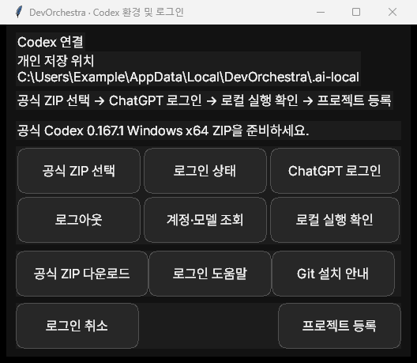

# DevOrchestra

DevOrchestra는 Windows에서 Codex 개발을 관리하는 Command Center입니다. 사용자가 목표, 완료 기준, 독립 Git 복제본, 허용 작업과 예산을 승인하면 Manager 계획 → Developer → 독립 Reviewer → 결정적 Verifier → 최종 Manager를 순서대로 실행합니다. 승인 범위 안에서 다음 사이클을 시작하고, 완료 또는 정해진 중단 조건에 도달하면 원장에 결과를 남깁니다.

## Windows x64 릴리스 후보

포터블 ZIP을 제공받았다면 압축을 풀고 `DevOrchestra.exe`를 실행하세요. ZIP의 `.sha256` 파일과 `Get-FileHash -Algorithm SHA256 <ZIP 경로>` 결과를 대조할 수 있습니다. EXE에 Python, Tcl/Tk와 UI 리소스가 들어 있습니다. 작업에 사용할 Git과 Codex는 별도로 준비합니다. GitHub Release 게시와 제품 배포 라이선스 결정은 소유자 승인 대기입니다.

1. **초기 설정**에서 사용자 저장소를 준비합니다. 새 포터블 설치는 `%LOCALAPPDATA%\DevOrchestra\.ai-local`을 사용합니다. EXE 옆에 기존 `.ai-local`이 있으면 그 위치를 계속 사용합니다. 업데이트는 ZIP을 새 폴더에 풀어 실행하면 됩니다. 기존 EXE 옆 저장소 사용자는 동일 위치의 프로그램 파일만 교체해야 합니다.
2. **Codex 환경 및 로그인**에서 공식 Codex 0.167.1 Windows x64 ZIP을 가져옵니다. 앱은 고정 SHA-256, Codex 및 동반 실행기의 Windows 서명과 버전을 확인합니다. 다른 버전은 호환성 검증을 거친 뒤 지원할 수 있습니다. [공식 Codex ZIP](https://github.com/openai/codex/releases/tag/rust-v0.167.1)
3. **ChatGPT 로그인**에서 브라우저의 공식 로그인 절차를 완료하고 **로그인 상태**를 확인합니다. 계정을 바꿀 때는 이 앱의 전용 연결에서 로그아웃한 뒤 다시 로그인합니다. **계정·모델 조회**에서 계정과 제공자 한도를 확인합니다. 목록 조회 실패, 구독 권한 제한 또는 모델 미지원은 서로 다를 수 있습니다. [OpenAI 공식 Codex 인증 문서](https://learn.chatgpt.com/docs/auth?surface=cli)
4. Git을 준비하고 **로컬 실행 확인**을 실행합니다. 이 검사는 로컬 합성 응답과 소유 Job으로 Codex 명령을 확인합니다. [Git for Windows](https://git-scm.com/install/windows)
5. **프로젝트 등록**에 원본 폴더, 목표와 완료 기준을 지정합니다. **Git 온보딩**에서 원본과 분리된 작업 복제본을 확인한 뒤, **개발 시작**에서 편집 파일, 검증 명령과 기대 출력, 허용 작업, 시간·토큰·사이클 예산을 검토하고 승인합니다. 단순 텍스트 프로젝트는 **Windows 텍스트 검사 예제**로 별도 Python 없이 파일 내용과 기대값을 비교할 수 있습니다.
6. 개발 운영실과 기록·복구에서 역할 상태, 검증 결과, 변경 내용과 토큰을 확인합니다. 작업이 멈춘 경우 원장에 표시된 복구 경로를 검토합니다. 원본에 적용할 때는 별도 승인과 원본 Git 기준 재확인이 필요합니다.

시간과 토큰은 다음 역할 또는 사이클의 시작을 제어하는 소프트 기준입니다. 기준에 도달하면 진행 중인 작업은 허용된 마무리 범위 안에서 정리합니다. 사용자 취소, 무응답, 권한 위반 및 소유권 불명확 상태에는 별도 중단 조건이 적용됩니다. 세션 토큰 예산과 ChatGPT 계정의 제공자 한도는 별개입니다. 모델과 한도는 계정 및 제공자 응답에 따라 달라집니다. 이 앱의 등록 개발 세션은 공식 CLI의 ChatGPT 구독 로그인을 사용합니다.

## 백업과 문제 해결

- 업데이트 전에 Command Center를 닫고 사용자 저장소의 원장, 등록부, 지침 및 복구 자료를 비공개 위치에 백업합니다. 다른 사용자에게 옮길 때는 전용 Codex 인증 홈을 제외하고 공식 로그인으로 다시 연결합니다. 원본 Git과 작업 복제본은 사용자 저장소와 별도로 백업합니다.
- 자동 개발 검토에서 ChatGPT 연결 안내가 나오면 **Codex 환경 및 로그인**에서 **로그인 상태**를 확인합니다. 계정은 연결됐으나 제공자 조회가 실패하면 네트워크와 계정 권한을 확인합니다.
- 검토 단계가 남아 있는 실행은 **중단 작업 재개 검토**에서 추가 시간과 토큰을 별도로 입력합니다. 미확정 모델 요청은 기록·복구 화면에서 먼저 확인합니다.



## 확인된 범위와 제한

- 기존 개발 환경에서 공식 Codex CLI로 독립 Git 시험 프로젝트의 두 개발 사이클을 실제 완료했습니다.
- 등록 프로젝트의 Tk 승인, Git 복제본, MXC 검증과 원본 반영 검토는 모델 응답을 대체한 통합 시험에서 확인했습니다. 등록 텍스트 프로젝트에서 한도 종료 후 실제 온라인 재개도 검증했습니다.
- Godot 파일럿은 Windows 내보내기와 독립 플레이 검증 증거를 갖췄습니다. 전체 게임의 최종 완료 판정은 대기 중입니다.
- 다른 Windows 계정의 공식 로그인부터 실제 자동 개발까지 이어지는 신규 설치 종단 간 검증은 릴리스 합격 조건입니다. 현재 증거는 [현재 상태](https://github.com/RuinaR/DevOrchestra/blob/main/docs/CURRENT-STATUS.md)와 [릴리스 검증표](https://github.com/RuinaR/DevOrchestra/blob/main/docs/WINDOWS-RELEASE-QA.md)에 기록합니다.
- 로컬 GUI 캡처는 릴리스 검증 자료에 포함합니다. 사용자의 원장, 인증 홈과 실제 프로젝트는 로컬 저장소에서 관리합니다.

## 개발 및 빌드

Windows x64의 Python 3.12, Tk, Git과 PyInstaller가 설치된 깨끗한 체크아웃에서 실행합니다.

```powershell
python -m devorchestra.gui
python tools/build_windows_release.py 0.3.0
```

빌드 스크립트는 `.ai-local/release/` 아래 GUI EXE, ZIP, SHA-256과 빌드 매니페스트를 생성합니다. GitHub 저장소에는 소스·공개 역할 지침·런타임 리소스·문서와 테스트를 유지합니다. 폰트와 아이콘의 고지는 내장 UI 리소스에서 제공합니다. DevOrchestra 제품의 배포 라이선스는 소유자 결정 대기입니다.

[제품 정의](https://github.com/RuinaR/DevOrchestra/blob/main/docs/PROJECT-DEFINITION.md) · [아키텍처 및 개발 이력](https://github.com/RuinaR/DevOrchestra/blob/main/docs/ARCHITECTURE-ROADMAP.md) · [안전 정책](https://github.com/RuinaR/DevOrchestra/blob/main/docs/GLOBAL-SAFETY-POLICY.md) · [개발 인수인계](https://github.com/RuinaR/DevOrchestra/blob/main/docs/AI-HANDOFF.md)
